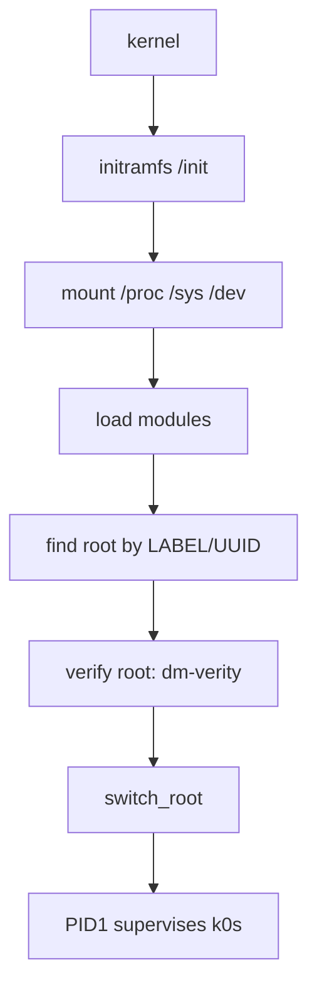

# The boot chain

Why the boot sequence is ordered the way it is. Nearly every step exists to
prevent a specific failure that was observed on a real boot; the ordering looks
arbitrary until you know what each one is for.

This is the *why*. For the normal workflow, see [Get started](../install/quick-start.md);
for KubeVirt or Cluster API, see [KubeVirt](../deployment/kubevirt.md).



```
firmware/QEMU/KubeVirt
  └── kernel (Kata guest kernel by default, Alpine linux-virt, or your own)
        └── initramfs: k0smos as /init          ← PID1, pre-switch
              ├── mount /proc /sys /dev /run /tmp …
              ├── read /proc/cmdline
              ├── export PATH                    (mkfs and k0s both need it)
              ├── load modules: named set, then autoload by modalias
              ├── choose root: explicit override → embedded EROFS → LABEL=k0smos
              ├── verify it against k0smos.verity=, if the image set one
              ├── mount it at /newroot
              └── switch_root ── exec /sbin/k0smos --switched-root
                    └── k0smos as /sbin/k0smos   ← PID1, post-switch
                          ├── mount anything that did not come across
                          ├── load modules (again; harmless if already in)
                          ├── prepare the data volume → /var
                          ├── set up cgroup2
                          ├── loopback up
                          ├── read the cloud-init drive (no mount)
                          ├── network: DHCP or static, write /etc/resolv.conf
                          │     ├── write_files → syscalls
                          │     ├── runcmd → interpreted, never executed
                          │     └── meta-data may supply the hostname
                          ├── set hostname
                          ├── install SIGCHLD reaper
                          ├── watch control port + power button
                          ├── supervise the workload
                          │     (k0s controller --single, unless user-data
                          │      names a role and join token)
                          └── on shutdown request:
                                k0s etcd leave (controllers, not --single)
                                killall TERM → grace → KILL
                                sync → unmount → sync → remount / ro
                                reboot(2)
```

Two orderings in there are load-bearing and easy to get backwards: the data volume
is mounted before anything can write to `/var`, and the cloud-init drive is read
before networking so it can supply the machine's address.

## What the chain verifies

The ROOT partition of a packaged image carries a dm-verity hash tree behind the
filesystem, and `grub.cfg` passes the root hash that tree must produce as
`k0smos.verity=`. PID1 maps the partition through dm-verity before mounting it,
so a block that does not hash to what the tree says fails to read. The tree's
own blocks are hashed too, up to that one root hash, so editing the data *and*
the tree does not help either. A node whose disk was altered offline stops with
`switch root: verify root /dev/sda2: ...` on the console instead of booting and
joining the cluster.

The salt is empty on purpose, which makes the tree a pure function of the root
filesystem: the same root image always produces the same root hash, so the hash
on a node's command line names the exact bytes that node booted. It does not
follow that two builds of one commit agree on it — the root is not byte-for-byte
reproducible today — so the hash identifies an artifact, not a source revision.

!!! note "What this does not prove"

    The root hash travels in `grub.cfg` on the ESP, a plain vfat partition with
    nothing signed. Whoever can rewrite the root can rewrite the hash beside it,
    so this detects a **changed root**, not a **substituted image**: the anchor
    is the ESP, not the hardware. Moving the anchor means shipping kernel,
    initramfs and cmdline as one signed UKI and enrolling a Secure Boot key --
    the cmdline has to be *inside* the signature, or it is this again one level
    up. That needs a key to manage, so the decision is not made here.

    The other partitions are not covered. `/var` is mutable by design and cannot
    be; the optional driver partition is read-only but unverified.
